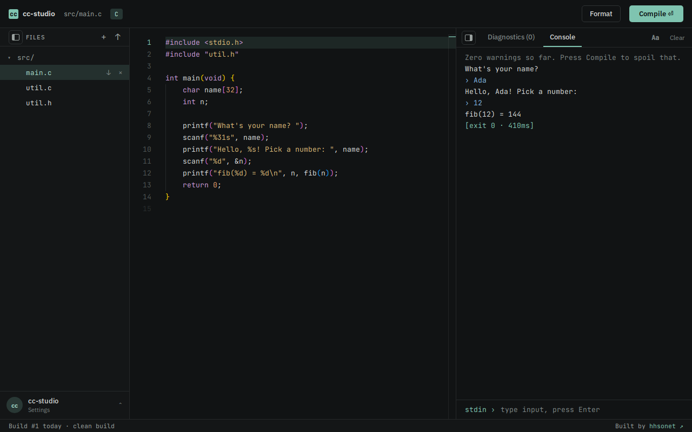
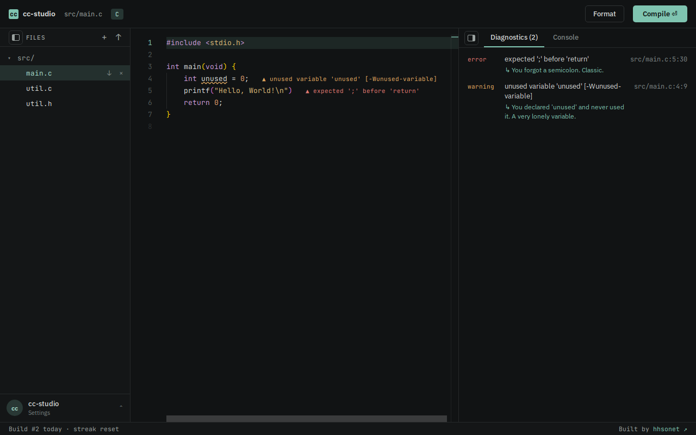

# cc-studio

**Write, compile and run C and C++ in your browser, with a live console.** Your program prints a prompt,
waits while you type, and carries on, like a real terminal. Code is compiled and run in throwaway,
locked-down Docker containers.



- No accounts, no database, no build step. Your files live in your browser's localStorage.
- A small Node server runs each program in its own sandbox and streams the input and output over a WebSocket.
- Built to be shown to other people: it can serve a classroom of about 200 at once on a modest VPS.

## Contents

[Features](#features) · [Quick start](#quick-start) · [Using the app](#using-the-app) ·
[Configuration](#configuration) · [How it works](#how-it-works) · [Security](#security-model-and-limits) ·
[Capacity](#capacity) · [Deployment](#deployment) · [WebSocket protocol](#websocket-protocol) ·
[Project layout](#project-layout) · [Development](#development) · [Credits](#credits)

## Features

**Editor and files**
- Monaco editor (the editor from VS Code) with C and C++ highlighting, in dark or light, four accent colors.
- A file explorer: new file, upload, download, delete, nested folders. Several files per program,
  headers included.
- **Only the open file's folder is built.** Open `src/main.c` and the `.c` files under `src/` are compiled
  and linked; `src-2/` can have its own `main.c` and be run on its own. Files in other folders are still
  available to `#include`.
- **Format** button (`Shift+Alt+F`): the real `clang-format`, compiled to WebAssembly and run in your
  browser, so nothing is sent anywhere. Choose LLVM, Google, GNU, Chromium, Mozilla, WebKit or Microsoft style.
  One undo step reverts it.
- **Auto indent** on or off, and an **indent size** of 2, 4 or 8 spaces.

**Running**
- A real interactive console: output appears as it is printed (even a prompt with no newline), and what you
  type goes to the program's stdin. `Ctrl+C` stops it, `Ctrl+D` ends the input.
- Compiler warnings and errors (`-Wall`) are parsed into a **Diagnostics** tab and drawn inline in the editor.
  The console stays clean: a build with warnings prints nothing from the compiler, a failed build prints
  just its errors.



**Friendly mode** (on by default, in Settings)
- A plain-English hint under common compiler and linker errors (*"You forgot a semicolon. Classic."*) and a
  note after crashes and limits (a segfault, a division by zero, a runaway loop).
- A quip on the empty console, a few easter eggs in the stdin box, and a build counter and streak in the
  bottom bar. Turn it off for the raw output.

**Comfort**
- Collapsible sidebar and panel (they shrink to a slim rail), and a separate font size and text color for
  the console.
- Works on a phone-sized screen; if the editor library can't load, a plain textarea takes over.

## Quick start

You need **Node.js 20+** and **Docker**.

```bash
git clone https://github.com/hhsonet/cc-studio.git
cd cc-studio

docker pull gcc:13                  # the compiler image the sandboxes use
sudo usermod -aG docker "$USER"     # let your user run docker, then log out and back in

npm install
npm start
```

Open <http://localhost:3000>. The log should say `Runner ready (Docker image gcc:13)`. Press **Compile**.

If Docker isn't usable, the app still starts, but **Compile** answers "The code runner failed to start" or
"Interactive mode is not available". Run `docker image inspect gcc:13` as the same user to check.

> Being in the `docker` group is equivalent to root access for that user. Run cc-studio as a dedicated,
> unprivileged user on a machine that has nothing else valuable on it.

## Using the app

| Key | Does |
|-----|------|
| `Ctrl/Cmd + Enter` | Compile and run |
| `Shift + Alt + F` | Format the open file |
| `Enter` (in `stdin ›`) | Send a line of input |
| `Ctrl + C` (in `stdin ›`) | Stop the running program |
| `Ctrl + D` (in `stdin ›`) | End of input (EOF) |
| `↑` / `↓` (in `stdin ›`) | Earlier inputs |
| `Esc` | Close a menu |

Input typed before the program has started is delivered as soon as it does.

**Console commands** (type them at `stdin ›` while no program is running; a running program always
receives exactly what you type):

| Command | Does |
|---------|------|
| `about` (also `sonet`, `hhs`, `hasan sonet`) | Shows the author card |
| `ls` | Lists your files |
| `clear` | Clears the console |
| `help` | Lists these, plus a few jokes (`sudo`, `whoami`, `make coffee`, ...) |

**Settings** (the avatar at the bottom of the sidebar): theme, accent color, editor font size, auto indent,
indent size, format style and Friendly mode. The **Aa** button in the console sets its own font size and
text color. Changing a setting never rewrites code you already wrote.

## Configuration

Copy `.env.example` to `.env`, or set the variables in the environment. All are optional.

| Variable | Default | Purpose |
|----------|---------|---------|
| `PORT` | `3000` | Port the server listens on |
| `RUNNER_IMAGE` | `gcc:13` | Docker image used to compile and run code. It must already be pulled |
| `TRUST_PROXY` | on | The per-IP limits believe `X-Forwarded-For` when the connection comes from loopback (a reverse proxy on the same host). Set to `false` if nothing is in front of the app |
| `MAX_SESSIONS` | `200` | Programs alive at once. Most are just waiting for input, about 15 MB each |
| `MAX_COMPILES` | cores - 1 | Container starts and compiles running at once; the rest wait in line |
| `RUNS_PER_MINUTE` | `60` | Runs per IP per minute (generous, because a classroom can share one IP) |
| `CONNS_PER_IP` | `30` | Simultaneous WebSocket connections per IP |

To change the author name and link shown by the credit and the `about` card, edit the `AUTHOR` constant at
the top of `public/app.js`.

## How it works

```
browser ──HTTPS / WSS──▶ reverse proxy (Caddy) ──▶ Node + Express (:3000) ──docker run──▶ gcc container
   │                                                  │  static files + /ws/run                (one per run)
   └─ files, settings and stats stay in localStorage   └─ nothing is stored on the server
```

1. The page sends the project's files and the open file to `/ws/run`.
2. The server validates them (names, sizes, language), writes them to a fresh temp directory and starts
   **one container**.
3. Inside it, a short shell wrapper compiles with `gcc` or `g++`, prints a marker on stderr, and then
   `exec`s the program under `stdbuf` so its output is unbuffered (a prompt with no newline still appears).
   The server uses the markers to tell compiler output from the program's own output.
4. Your input is written to the program's stdin; output and the final exit status stream back.
5. When the run ends, or the tab closes, the container is killed and the temp directory deleted.

Compiler flags: `gcc -std=gnu17 -Wall -O1` for C (plus `-lm`), `g++ -std=gnu++17 -Wall -O1` for C++, with
the project root and the open file's folder on the include path.

## Security model and limits

Every run happens in a container with:

| Protection | Setting |
|------------|---------|
| Network | none (`--network none`) |
| Privileges | all capabilities dropped, `no-new-privileges`, non-root user (`65534`) |
| Filesystem | read-only root; your source mounted read-only; a 64 MB tmpfs for the binary |
| Resources | 192 MB memory (no swap), 1 CPU, 64 processes, 256 open files |
| CPU time | 10 s of CPU (waiting for your input costs nothing) |
| Wall clock | 5 minutes per run, 60 s without any input or output |
| Output | 1 MB, then the program is stopped |

Server side: one origin only (WebSocket upgrades from other sites are refused), a strict
Content-Security-Policy, size and name validation (`..`, absolute paths and odd characters are rejected;
at most 20 files and 64 KB in total), per-IP run and connection limits, and a global cap on live programs.
The page needs `'wasm-unsafe-eval'` in its CSP for the in-browser formatter; ordinary `eval()` stays blocked.

Docker isolation is not as battle-tested as a dedicated judge such as isolate or Judge0. Keep Docker and the
kernel up to date, and don't run anything else valuable as the same user.

## Capacity

Measured on an 8-core, 16 GB VM with a real Docker daemon:

- A program waiting at an input prompt costs about **15 MB** and no CPU, so 200 live sessions use roughly 3 GB.
- Starting a container and compiling is the expensive part. The host sustains about **4 new runs per
  second** (load average near 7 of 8 cores); raising `MAX_COMPILES` beyond cores - 1 does not help.
- 200 users each pressing Run once, spread over a minute: every run succeeded, median time to first output
  1.2 s, slowest 3.9 s.
- 200 users pressing Run in the *same second*: every run succeeded, but they queue (median wait about 25 s,
  slowest about 50 s).

For sustained load above roughly 4 runs per second, use a bigger machine or a second instance.

## Deployment

On the server: put the app in `/opt/cc-studio`, run `npm ci --omit=dev`, create `.env`, make sure the service
user is in the `docker` group and has pulled the image (`docker pull gcc:13`).

**pm2**

```bash
sudo npm install -g pm2
cd /opt/cc-studio
pm2 start server.js --name cc-studio
pm2 save
pm2 startup        # run the command it prints, so the app restarts on boot
```

**systemd** (`/etc/systemd/system/cc-studio.service`)

```ini
[Unit]
Description=cc-studio
After=network.target docker.service
Requires=docker.service

[Service]
WorkingDirectory=/opt/cc-studio
ExecStart=/usr/bin/node server.js
EnvironmentFile=/opt/cc-studio/.env
Restart=on-failure
User=ccstudio
SupplementaryGroups=docker
NoNewPrivileges=true
PrivateTmp=false
LimitNOFILE=65535

[Install]
WantedBy=multi-user.target
```

`LimitNOFILE` is for about 200 sessions, each holding several pipes and sockets. `PrivateTmp` stays off
because each run's source is written to a temp directory that Docker must be able to mount.

```bash
sudo systemctl daemon-reload
sudo systemctl enable --now cc-studio
journalctl -u cc-studio -f
```

**Caddy** (`/etc/caddy/Caddyfile`; Caddy fetches the HTTPS certificate itself and proxies WebSockets with no
extra configuration)

```caddyfile
code.example.com {
    encode zstd gzip
    reverse_proxy localhost:3000
}
```

Over plain HTTP (for example `http://<ip>:3000`) everything works too; the app turns off the
`upgrade-insecure-requests` CSP directive so the CSS and scripts still load.

## WebSocket protocol

Endpoint: `/ws/run`, JSON text messages.

Client to server:

| Message | Meaning |
|---------|---------|
| `{type:"run", language:"c"\|"cpp", files:[{path, content}], entry}` | Start a run. `entry` is the open file; only the sources in its folder are compiled. `source_code` is accepted instead of `files` for a single main file |
| `{type:"input", data}` | Text for the program's stdin (at most 4 KB per message, 64 KB per run) |
| `{type:"eof"}` | Close stdin |
| `{type:"kill"}` | Stop the program |

Server to client:

| Message | Meaning |
|---------|---------|
| `{type:"compile", text, ok}` | Compiler output. `ok:false`: the build failed and nothing runs. `ok:true`: warnings only |
| `{type:"started"}` | The program is running |
| `{type:"out", stream, data}` | stdout or stderr text |
| `{type:"exit", code, signal, reason, ms}` | The run ended. `reason` is one of `compile_error`, `timeout`, `idle`, `cpu_limit`, `memory_limit`, `output_limit`, `killed`, or empty |
| `{type:"error", code, message}` | `code` is `invalid`, `rate_limited`, `busy`, `unavailable` or `internal` |

Limits on `files`: at most 20, 64 KB in total; paths are relative, use `A-Za-z0-9_.-/`, and end in `.c`,
`.cpp`, `.cc`, `.cxx`, `.h`, `.hpp`, `.hh`, `.hxx` or `.txt`.

## Project layout

```
server.js             Express app: security headers, static files; starts the HTTP and WebSocket servers
lib/interactive.js    /ws/run: protocol, per-IP limits, origin check, session cap
lib/runner.js         Docker runner: one container per run, limits, markers, signals
lib/validate.js       Request validation and the "which files to compile" rule
public/
  index.html          The page
  app.js              Editor, files, panels, console, settings, running
  friendly.js         Friendly mode: error hints, crash notes, quips, easter eggs, build stats
  format-config.js    The clang-format settings used by the Format button
  style.css, fonts.css, fonts/    Look and self-hosted fonts
  vendor/clang-format/            clang-format compiled to WebAssembly (unmodified)
tests/                node:test suite
docs/                 Screenshots used in this README
```

There is no build step: the files in `public/` are served as they are. Monaco is loaded from jsDelivr.

## Development

```bash
npm install
npm test          # runs the whole suite
npm start         # PORT=3100 npm start to use another port
```

The tests need **neither Docker nor the compiler image**: they use a fake runner for the WebSocket protocol
and a fake `docker` executable to exercise the real runner's process handling (compile errors, crashes,
kill, idle and output limits, the compile queue). They also load the same WebAssembly formatter as the
browser, and check validation, the Friendly-mode table and the server's headers.

To check the real thing end to end, start the app with Docker access and run a program in the browser.

## Credits

- [Monaco Editor](https://github.com/microsoft/monaco-editor) (MIT), loaded from jsDelivr.
- [clang-format](https://clang.llvm.org/docs/ClangFormat.html) from LLVM (Apache-2.0 with LLVM exceptions),
  as WebAssembly via [`@wasm-fmt/clang-format`](https://github.com/wasm-fmt/clang-format) (MIT). Both license
  texts are in `public/vendor/clang-format/`.
- [IBM Plex Sans](https://github.com/IBM/plex) and [JetBrains Mono](https://github.com/JetBrains/JetBrainsMono)
  (SIL Open Font License 1.1), self-hosted; license texts in `public/fonts/`.
- The visual design follows a "C Compiler" design made in Claude Design.
- The compiler is `gcc`, from the official [`gcc` Docker image](https://hub.docker.com/_/gcc).

Built by [hhsonet](https://github.com/hhsonet).

## License

[MIT](LICENSE), Copyright (c) 2026 hhsonet.

The third-party pieces keep their own licenses, and their license texts are included next to the files they
cover: `public/fonts/IBM-Plex-OFL.txt`, `public/fonts/JetBrains-Mono-OFL.txt`,
`public/vendor/clang-format/LICENSE` (the WebAssembly wrapper, MIT) and
`public/vendor/clang-format/LLVM-LICENSE.txt` (clang-format itself, Apache-2.0 with LLVM exceptions).
